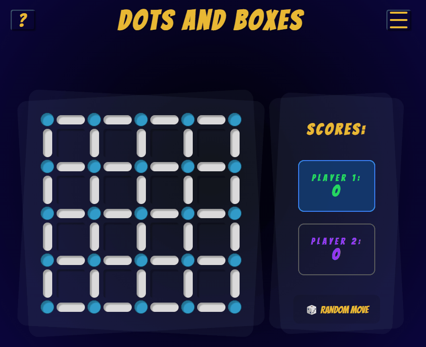
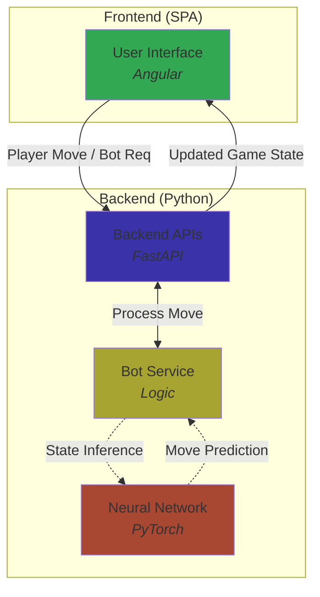

# ♟️ Dots and Boxes - AI Monorepo


Full-stack implementation of the game **Dots and Boxes**. This project features a self-trained AI opponent based on a Neural Network and demonstrates a complete CI/CD lifecycle.

## 🚀 Status and Metrics

| Pipeline | Status | Coverage |
| :--- | :--- | :--- |
| **Frontend CI** | [](https://github.com/TillKaminski/dots-and-boxes/actions/workflows/frontend-ci.yml) | [](https://codecov.io/gh/TillKaminski/dots-and-boxes/flags/frontend) |
| **Backend CI** | [](https://github.com/TillKaminski/dots-and-boxes/actions/workflows/backend-ci.yml) | [](https://codecov.io/gh/TillKaminski/dots-and-boxes/flags/backend) |
| **CD Release** | [](https://github.com/TillKaminski/dots-and-boxes/actions/workflows/compose-cd.yml) | |

## 📺 Gameplay


## 🏗️ Architecture
The project uses a monorepo structure to keep the frontend and backend in one place while maintaining a clear technical separation.

- **🌐 Frontend**: Angular SPA using Signals for state management and CSS animations for an interactive game board. [See Details](./frontend/README.md)
- **⚙️ Backend**: FastAPI service providing the game engine, move validation, and session handling. [See Details](./backend/README.md)
- **🤖 AI**: PyTorch Feedforward Neural Network trained on generated game data. [See Progress](./backend/ai/outputs/model/MODELS.md)

## 🔄️ Dataflow
This diagram illustrates the core communication flow between the components. Note that it represents a simplified example of the move-processing logic.




## 🛠️ Quick Start (Docker Compose)

The easiest way to run the entire stack locally is using Docker Compose. The pipeline automatically builds and pushes the latest images to GitHub Packages.

1. **Download the latest release** (the `docker-compose.yml` is automatically generated by the CD pipeline).
2. **Run the application**:
   ```bash
   docker compose up
   ```
3. **Access the game**:
- Frontend: http://localhost:4200
- API Docs: http://localhost:8080/docs

## 🔧 Development Setup
If you want to run the components locally for development (requires backend on port `8000`):

### Backend
Requires Python 3.11

```bash
cd backend
pip install -r requirements.txt
uvicorn main:app --port 8000
```

### Frontend
Requires Node.js and Angular CLI

```bash
# open a new terminal
cd frontend
npm install
ng serve
```

## 🗺️ Future Improvements

This project is actively developed. The current focus is on enhancing the AI's performance and system stability.

- **Data Augmentation**: Tremendously increase training data by using rotations and mirror mapping of existing game states.
- **MCTS Integration**: Implementing Monte Carlo Tree Search to improve move evaluation.
- **AlphaZero Approach**: Transitioning to a combination of Reinforcement Learning and MCTS.
- **Persistence Layer**: Integration of a PostgreSQL database to manage concurrent games and move away from in-memory storage.

## 📌 Motivation
This project was built to demonstrate a full-stack architecture, the integration of AI models into web applications, and a CI/CD workflow.

You can track the progress in the [GitHub Issues Board](https://github.com/TillKaminski/dots-and-boxes/issues).

##  License

This project is licensed under the MIT License - see the [LICENSE](LICENSE) file for details.
