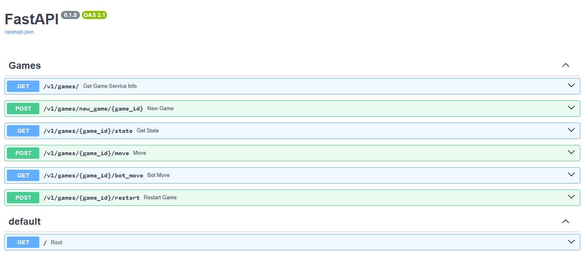

# Dots and Boxes - Backend and AI

This backend service provides the complete game logic for **Dots and Boxes** and exposes it via a RESTful API.  
It includes a PyTorch-based AI opponent with a full training pipeline: data generation → preprocessing → training → evaluation.

## Tech-Stack:
- **FastAPI** REST API framework for simple and fast API development
- **Pydantic** API Data model and Data validation
- **Uvicorn** Server for Development and Production
- **PyTorch** Neural Network (Feedforward Network) for AI Opponent

### Development Tools:
- **Python**: 3.11.0
- **Black**: Code formatting (v26.1.0)
- **Flake8**: Linting (v7.3.0)
- **Pytest**: Unit and integration testing (v8.4.2)

## Game Logic
The game is played on a symmetric $n \times n$ grid of boxes. The first version of the game uses a static board size of $n = 4$ (future releases may support variable board sizes).

### Field Configuration:
- **Board**: Symmetric ($n\times n$ Boxes).
- **Edges**: Divided into *horizontal* and *vertical*.
  - Horizontal: $n \times (n + 1)$
  - Vertical: $(n + 1) \times n$
  - Total: $2n(n + 1)$
- **Coordinates**: Each edge is uniquely identified by an `(x, y)` tuple and an `orientation` (`horizontal` | `vertical`).
  - `x`: Row index
  - `y`: Column index

**Example** (4 × 4 board):  
First rightmost horizontal edge → `x = 3`, `y = 0`, `orientation = 'horizontal'`

## REST API

The API is versioned and organized under the `/v1/games/` namespace.

### Endpoints

| Method | Endpoint | Description |
|------|----------|-------------|
| `GET` | `/` | Root healthcheck |
| `GET` | `/v1/games/` | Service info |
| `POST` | `/v1/games/new_game/{game_id}` | Initialize a new game session |
| `GET` | `/v1/games/{game_id}/state` | Fetch the current board state |
| `POST` | `/v1/games/{game_id}/move` | Execute a player move |
| `GET` | `/v1/games/{game_id}/bot_move` | Request a move from the AI |
| `POST` | `/v1/games/{game_id}/restart` | Reset the board |

### API Documentation (Swagger)

When the backend is running, interactive OpenAPI documentation is available at:

http://localhost:8080/docs (or port `8000` in development).



## AI Section

The AI predicts the optimal next move based on the current board state.

### Architecture
- **Model Type**: Feedforward Neural Network (FFN)
- **Input**: Encoded board state
- **Output**: Predicted move (edge + orientation)

### Model Evolution
A full history of all trained models and experiments is documented here:  

[`MODELS.md`](./ai/outputs/model/MODELS.md)

### AI Data and Training Pipeline:
CLI tools are provided to manage the full AI lifecycle. All scripts must be executed from the **project root**. Use the `--help` flag for detailed parameter descriptions.
1. **Data Generation** (Generates raw games in `.pt` format):
```bash
python -m backend.ai.data.data_generator --games 500
```
2. **Preprocessing** (Prepares raw data for the training loop):
```bash
python -m backend.ai.data.data_preprocessing --src "data_raw.pt"
```
3. **Model Training** (Starts the neural network training):
```bash
python -m backend.ai.training.training --it 100
```
4. **Evaluation** (Win-rates between different AI versions):
```bash
python -m backend.ai.bots.evaluation --n 100 --bot1 "random" --bot2 "rule"
```

## Local Setup

To run the backend without Docker:

```bash
# project-root
pip install -r backend/requirements.txt
uvicorn backend.main:app --port 8000
```

## Future Improvements
- **Data Augmentation**: Scale the training dataset while maintaining high data quality.
- **Advanced Algorithms**: Implement a Monte Carlo Tree Search (MCTS) bot.
- **Architecture**: Implement a Policy-Value-Network (AlphaZero approach).
- **Persistence**: Integration of a PostgreSQL database for session and process management.
