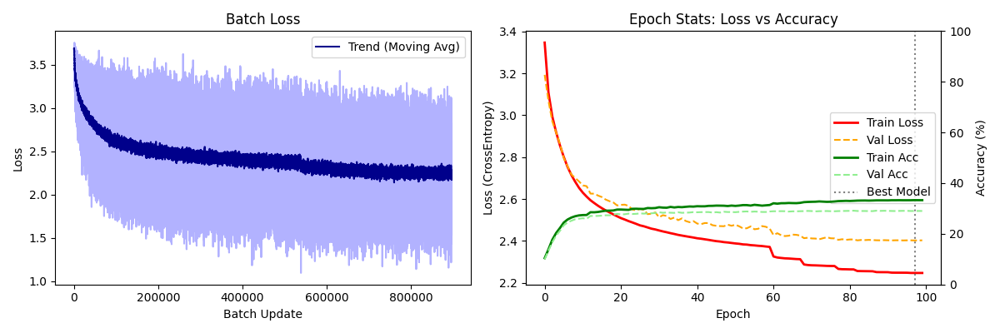
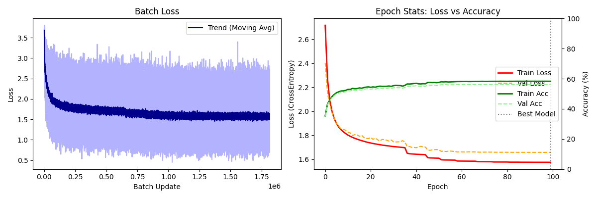

# AI Model Documentation

This section documents the versions of the Dots and Boxes AI models.

---

# Feed-Forward Neural Network (FFN)

## Input/Output
* **Input**: `(1, 56)` Vector representing 40 edges (20 horizontal, 20 vertical) and 16 boxes.
* **Output**: `(1, 40)` Vector providing a probability distribution over all possible moves.

## Model Paramters

| Parameter | Value |
| :--- | :--- |
| **Input Size** | 56 |
| **Output Size** | 40 |
| **Hidden Layers** | `[128, 128, 64]` |
| **Activation Function** | `ReLU` (Hidden) / `Softmax` (Output) |
| **Optimizer** | `Adam` |
| **Loss Function** | `CrossEntropyLoss` |
| **Early-Stop Patience** | `10` Epochs |

---

## Versions

>
> ### Version 1: "Basic Rules"
>
> **Filename:** `v1_rule_based_mix.pt`
>

### Training-Data
**Total:** 10,000 Games
- **20%** Random vs. Random
- **20%** Rule vs. Random
- **60%** Rule vs. Rule

### Training Progress

*Figure 1: Loss and Accuracy over 100 epochs.*

 ### Performance:
   - Wins against Random, draws/loses against Rule-Bot.
   - Draws (8:8) in Self-Play (deterministic).

### Benchmark (vs. Rule-Bot):

| RESULTS for Rule vs FFN | 1.000 Games |
| :--- | :--- |
| Wins (Rule) | 413 (41.3%) |
| Wins (FFN) | **429 (42.9%**) |
| Draws | 158 |
| Avg Score (Rule) | 6.38 |
| Avg Score (FFN) | **6.58** |

>
> ### Version 2: "Self-Play"
>
> **Filename:** `v2_self_play.pt`
>

### Training-Data

Noise ($\epsilon$) is added to the Feed-Forward Network to produce new (non-deterministic) data.

**Total:** 20,000 Games
- **10%** Rule vs. Rule
- **30%** Rule vs. FFN ($\epsilon=0.1$)
- **40%** FFN vs. FFN ($\epsilon=0.15$ both)
- **20%** FFN ($\epsilon=0.2$) vs. FFN ($\epsilon=0$)

### Training Progress

*Figure 1: Loss and Accuracy over 100 epochs.*

 ### Performance:
   - Increased Win-Rate against Rule-Bot.
   - Network learned to beat old Model.
   - Further Generalization due to Data-Augmention.

### Benchmark (vs. Rule-Bot and old Model):

| RESULTS for Rule vs FFN | 1.000 Games |
| :--- | :--- |
| Wins (Rule) | 390 (39.0%) |
| Wins (FFN) | **461 (46.1%)** |
| Draws | 149 |
| Avg Score (Rule) | 6.25 |
| Avg Score (FFN) | **6.80** |

| RESULTS for FFN vs FFN old | 1.000 Games |
| :--- | :--- |
| Wins (FFN) | **500 (50.0%)** |
| Wins (FFN old) | 0 (0.0%) |
| Draws | 500 |
| Avg Score (FFN) | **8.50** |
| Avg Score (FFN old) | 5.50 |
