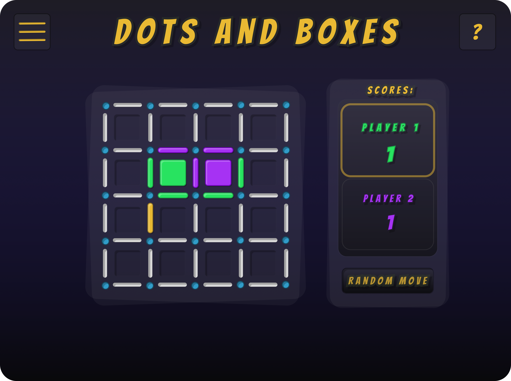
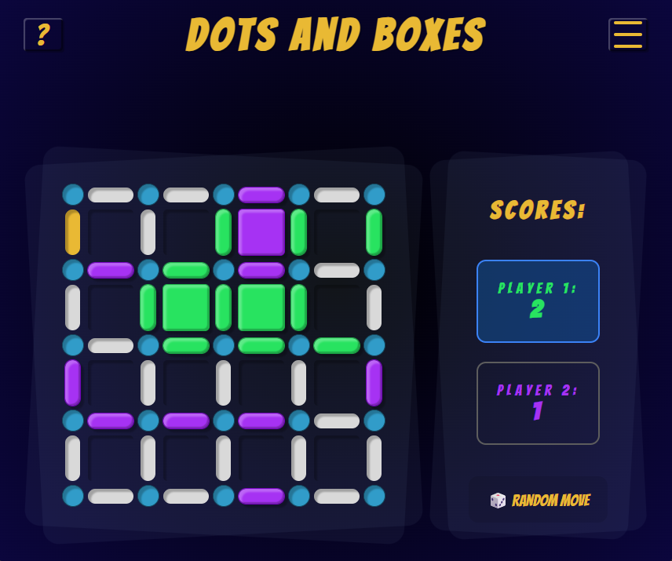

# Dots and Boxes - Frontend
This is the user interface for the **Dots and Boxes** game. It is implemented as a Single Page Application (SPA) using Angular and communicates with a FastAPI backend for playing against a PyTorch-based AI opponent.

## Tech Stack
- **Angular 17**: Modern frontend framework with standalone components and signals.
- **Nginx**: Web server used for hosting the application in the Docker environment.

### Development Tools:
- **Node.js**: v22.x (LTS)
- **Angular CLI**: 17.3.17
- **Jest**: Unit testing (replacing default Karma/Jasmine setup)
- **ESLint & Prettier**: Code quality and formatting

## Key Features
- **Central State Management**: The game state is managed in a main component and passed down to ensure the board and scores are always synchronized.
- **Design and Animations**: Player interactions are supported by CSS animations (e.g., setting an edge, scoring a box).
- **Request Handling**: To prevent race conditions or duplicate moves, user input is temporarily disabled while waiting for the response from the backend.

## UI Design
The UI was first designed in **Figma** to plan the layout and user flow before implementation.

### Design vs. Implementation
| Figma Prototype | Final Implementation |
| :---: | :---: |
|  |  |


## Project Structure

The project is organized into modules to keep the logic separated and maintainable:

```text
src/app/
├── core/
│   ├── services/  # Communication with the API and state management
│   └── models/    # Data structures (Interfaces) for games and moves
└── features/
    └── game/
        ├── pages/      # Main container for the game screen
        └── components/ # Individual parts (board rendering, menu, and score display)
```

## Local Setup
To run the frontend without Docker:
```bash
npm install
ng serve
```

The app will be available at http://localhost:4200/.

**Note on Backend Ports**:

- **Development** expects the backend on port `8000`.

- **Production** (Docker) expects the backend on port `8080`. 

These settings are managed in the `src/environments/` folder.
